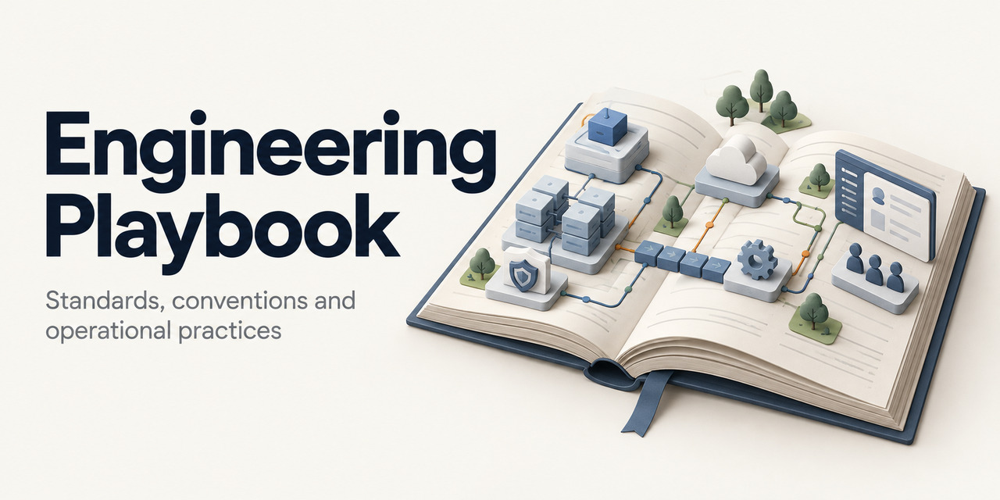

# Engineering Playbook

Standards, conventions and operational practices for my projects, labs and public portfolio.

For purpose and scope, see [OVERVIEW.md](./OVERVIEW.md). For the human and
professional principles behind these standards, see
[Professional Principles](./principles/).

## Web Version

[engineering-playbook-web](https://github.com/robmoraes/engineering-playbook-web)
is a navigable web version of this playbook with indexing and search. It is
intended to run locally and offline with Docker for quick reference, or to
serve as a context memory of engineering standards for AI-assisted
programming.

- Docker Hub:
  <https://hub.docker.com/r/robmoraes/engineering-playbook-web>
- GitHub: <https://github.com/robmoraes/engineering-playbook-web>

## Navigation

| Area | Content |
| --- | --- |
| [Principles](./principles/) | Mission, user responsibility, ethics and long-term stewardship |
| [DevOps](./devops/) | Shared ownership, delivery flow, feedback, automation and continuous improvement |
| [SRE](./sre/) | Service-level objectives, production readiness, sustainable response and reliability engineering |
| [Architecture](./architecture/) | Technical rationale, application standards, spec-driven workflow and decision records |
| [UX](./ux/) | User journeys, intuitive screens, efficient forms, accessible interaction and usable recovery |
| [CI/CD](./ci-cd/) | Integration, releases and deployment pipelines |
| [Docker](./docker/) | Container builds, images and runtime conventions |
| [Examples](./examples/) | Reusable reference implementations |
| [GitHub](./github/) | Repository configuration and collaboration standards |
| [Infrastructure](./infrastructure/) | Platform, routing, storage and availability |
| [Naming](./naming/) | Shared resource naming conventions |
| [Observability](./observability/) | Logging, metrics, dashboards and alerts |
| [Repositories](./repositories/) | Repository organization standards |
| [Runbooks](./runbooks/) | Operational and recovery procedures |
| [Security](./security/) | Secrets, access and credential practices |
| [Testing](./testing/) | Risk-focused Test Case design, execution evidence and lifecycle standards |

## Social Preview

The repository cover and instructions for configuring link previews are in
[Social Preview Assets](./assets/social-preview/README.md).

## Maintainer

Carlos R Moraes Rodrigues

- GitHub: https://github.com/robmoraes
- Docker Hub: https://hub.docker.com/u/robmoraes
- Website: https://about.robmoraes.dev.br/
